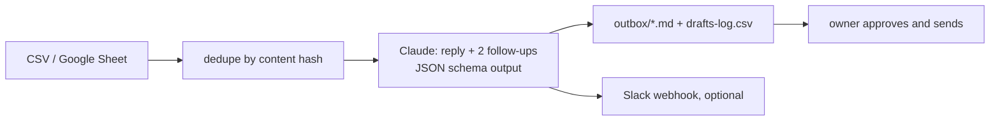

# Lead Response Agent

A Node.js agent that watches a local business's inbound leads and, within a minute of each one arriving, drafts a personalized reply plus a two-step follow-up sequence with Claude. The owner reads, approves and sends; nothing goes out automatically.

## Why

Small service businesses (HVAC, dental, real estate, salons, contractors) get leads at 8pm or while the owner is on a job, and the first company to answer usually wins. This agent removes the writing step: every lead gets a ready-to-send reply in the owner's voice, referencing what the customer actually asked, with the booking link and phone number.

## Features

- **Zero-setup lead sources:** a local CSV, a CSV URL, or any Google Sheet shared as "anyone with the link can view" (no OAuth).
- **Never drafts twice:** each lead gets a content-hash ID; handled IDs persist in `.state.json`.
- **Structured drafts:** one Claude call per lead with a JSON schema output, so every draft parses into reply subject, reply body, follow-up 1, follow-up 2, a lead-quality flag (hot / warm / cold / spam) and notes for the owner.
- **Vertical playbooks:** tuned instructions for `hvac`, `dental`, `realestate`, `salon`, `contractor` and `generic`; adding one is a single object in `src/prompts.js`.
- **Prompt caching:** the business profile and playbook form a cached system prompt shared across leads.
- **Delivery:** one Markdown file per lead in `outbox/`, a running `outbox/drafts-log.csv`, and an optional Slack incoming-webhook post for approve-from-your-phone.
- **Offline demo:** `--mock` produces deterministic drafts so the whole pipeline runs without an API key.
- **Sales kit:** `sales/` holds the pitch, a five-minute demo script and the onboarding email used to sell it as a monthly service.

## How it works



| File | Role |
|---|---|
| `src/sources.js` | Reads leads from a CSV path, CSV URL or Google Sheet share link |
| `src/state.js` | Tracks handled lead IDs |
| `src/prompts.js` | System prompt, vertical playbooks and the draft JSON schema |
| `src/draft.js` | Claude API call (structured output, cached system prompt) and the mock drafter |
| `src/deliver.js` | Writes the Markdown draft, appends the CSV log, posts to Slack |
| `src/index.js` | CLI: `run`, `watch`, `reset` |

## Tech stack

Node.js 18+ (ES modules), `@anthropic-ai/sdk`, no other runtime dependencies.

## Getting started

```sh
npm install
npm run demo              # 10 sample HVAC leads, mock drafts, no API key needed

cp .env.example .env      # add ANTHROPIC_API_KEY
npm run demo:live         # same leads, real Claude drafts
```

Then open `outbox/`.

| Command | What it does |
|---|---|
| `npm run demo` | Process `data/sample-leads.csv` with mock drafts |
| `npm run demo:live` | Same, with real Claude drafts |
| `npm run run` | Process new leads from the configured source once |
| `npm run watch` | Poll the source every `poll_minutes` |
| `npm run reset` | Forget which leads were handled |
| `node src/index.js run --source <path-or-url>` | One-off run against any source |

Environment variables (`.env.example`): `ANTHROPIC_API_KEY` (required for live drafts), `SLACK_WEBHOOK_URL` (optional), `ANTHROPIC_MODEL` (optional override).

### Configuring a business

Edit `config.json`:

```json
{
  "business": {
    "name": "Summit Heating & Air",
    "vertical": "hvac",
    "owner_name": "Sam",
    "phone": "(555) 555-0100",
    "booking_link": "https://calendly.com/summit-hvac/estimate",
    "service_area": "the greater metro area",
    "tone": "friendly, professional, and prompt"
  },
  "source": "https://docs.google.com/spreadsheets/d/SHEET_ID/edit",
  "delivery": { "outbox_dir": "outbox", "slack_webhook_url": "" },
  "poll_minutes": 5
}
```

Expected lead columns: `name, email, phone, message, service, source`. Extra columns are passed to the model as context. For several businesses, run one copy per business with its own `config.json` under `pm2`, `launchd` or cron.

## Project structure

```
src/                 agent code (sources, state, prompts, drafting, delivery, CLI)
data/sample-leads.csv  ten fictional HVAC leads for the demo
config.json          business profile, lead source, delivery settings
sales/               pitch, demo script, onboarding email
.env.example         API key and optional settings
```

## Status

Working prototype. The mock pipeline runs end to end on the bundled sample leads; live mode makes one Claude call per lead. Not yet running for a paying business.

Built by [Ian Royes](https://github.com/ianroyes-sys)
